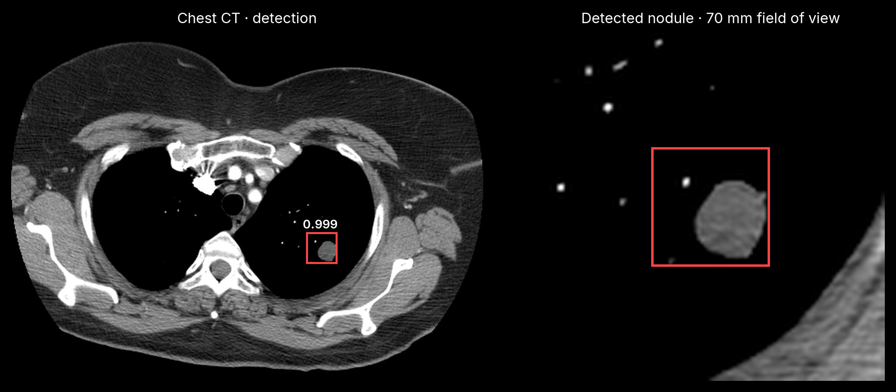

<div align="center">

# lung-nodule-mlx

Detect lung nodule candidates in 3D chest CT with MONAI RetinaNet and native MLX.

[](https://pypi.org/project/lung-nodule-mlx/)
[](https://pypi.org/project/lung-nodule-mlx/)
[](https://github.com/MedMLX/lung-nodule-mlx/blob/v0.2.7/LICENSE)
[](https://github.com/ml-explore/mlx)
[](https://huggingface.co/MedMLX/retinanet-lung-nodule-mlx)
[](https://github.com/MedMLX/medmlx)

[Model weights](https://huggingface.co/MedMLX/retinanet-lung-nodule-mlx) · [MedMLX](https://github.com/MedMLX/medmlx)



</div>

| Input | Output |
| :--- | :--- |
| 3D chest CT · NIfTI | Candidate boxes and scores in RAS mm |

Weights: 85 MB download. Peak MLX memory: 10.7 GB for a 512×512×147 chest CT resampled to the model grid.

## Use with MedMLX

Use the [MedMLX MCP server](https://github.com/MedMLX/medmlx/blob/main/docs/mcp.md) to run `lung-nodule` from an MCP client. Weights download on first use.

```sh
uv tool install --python 3.13 "medmlx[vision,mcp]"
MEDMLX="$(uv tool dir --bin --color never)/medmlx"
mkdir -p "$HOME/medmlx-work"
claude mcp add --scope user medmlx -- "$MEDMLX" serve --root "$HOME/medmlx-work"
```

For Codex, use `codex mcp add medmlx -- "$MEDMLX" serve --root "$HOME/medmlx-work"`. Other MCP clients take the same command and arguments. The same install provides the `medmlx` CLI, for example `medmlx describe lung-nodule`.

## Install

```bash
uv venv --python 3.13
source .venv/bin/activate
uv pip install "lung-nodule-mlx>=0.2.7"
```

## Run

```python
from lung_nodule_mlx.medmlx import run

result = run(image_path="ct.nii.gz", output_dir="out", resample_raw_input=True)
print(result["outputs"]["detections"])
```

Weights download from `MedMLX/retinanet-lung-nodule-mlx` on first use.
Use `medmlx setup lung-nodule` to download ahead of time. For local weights, pass a folder containing `network.safetensors` as `weights_path`.

### Inputs and outputs

| Argument | Meaning |
| --- | --- |
| `image_path` | One scalar 3D chest CT in NIfTI, in Hounsfield units, with `mm`, `meter` or `micron` spatial units |
| `output_dir` | Directory for `detections.json` and `bundle_detections.json`; created if missing |
| `weights_path` | Optional folder containing `network.safetensors`, or the file itself |
| `overwrite` | `False` by default; existing outputs are never replaced |
| `resample_raw_input` | `False` requires the bundle's 0.703125 × 0.703125 × 1.25 mm grid; `True` resamples first |

Keep `resample_raw_input=True` for ordinary CT. The default follows the bundle's
pre-resampled mode: it reorients to RAS and scales intensities without resampling, and
rejects images whose voxel axes are more than 1e-3 mm from the bundle grid or sheared,
the cases where the bundle's resampling would change the image. Spatial units are converted to millimetres; unknown units are
rejected. DICOM series are not read.

`detections.json` holds `medmlx.detections.v1` candidate boxes (`cccwhd`, class 0
`nodule`) in RAS millimetres with their scores; `bundle_detections.json` holds the
MONAI bundle rows in patient LPS. Boxes map through the affine with MONAI's
opposite-corner convention, so on oblique affines they differ from a box enclosing all
eight corners. `run` returns `{"outputs": {...}, "details": {...}}`, with run metadata in `details`.
Invalid inputs raise
`InvalidInputError`; missing or mismatched weights raise `AssetNotReadyError`.

### Python API

```python
from pathlib import Path

from medmlx_core.runtime import import_mlx
from lung_nodule_mlx import RetinaNet, boxes_to_world, detections, predict_maps
from lung_nodule_mlx.medmlx import prepare_image

image, affine = prepare_image(Path("ct.nii.gz"), resample_raw_input=True)
mx = import_mlx()
network = RetinaNet(mx.load("network.safetensors"), mx=mx)
maps, padded_shape = predict_maps(image, network)
boxes, scores, labels = detections(maps, padded_shape, image.shape[2:])
world_ras = boxes_to_world(boxes, affine)
```

Arrays are float32 NCDHW in MONAI's `(i, j, k)` order, and `detections` returns voxel
boxes. Box selection uses stable NumPy top-k and needs no compiler; tied scores keep
their original order, so overlapping boxes can differ from MONAI runs when scores tie.
Inference requires Apple Silicon with Metal.

## License

[Apache-2.0](https://github.com/MedMLX/lung-nodule-mlx/blob/v0.2.7/LICENSE). See [third-party notices](https://github.com/MedMLX/lung-nodule-mlx/blob/v0.2.7/THIRD_PARTY_NOTICES.md). Model weights retain their publisher terms.
